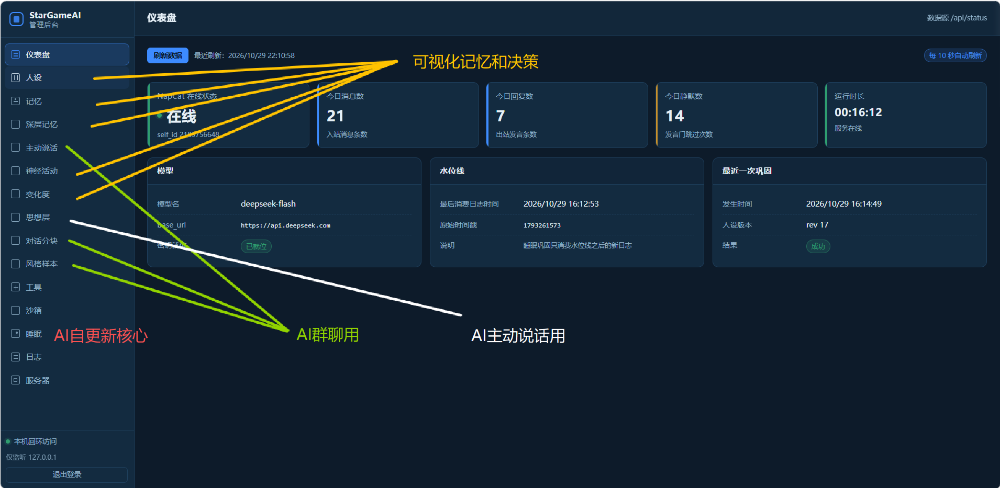
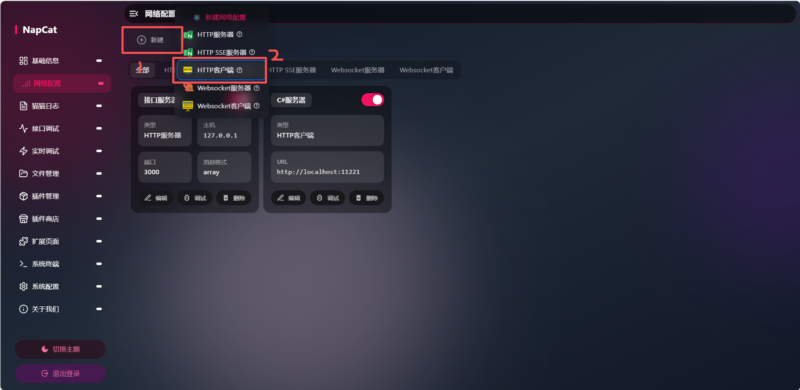
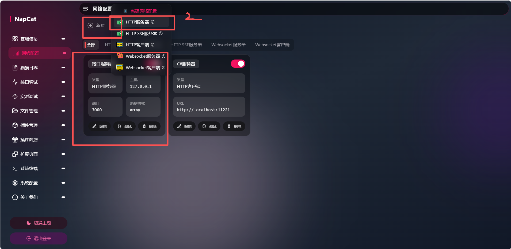

# StarGameAI

**一个会自己长人格的 QQ AI 机器人。** C# 自托管服务端，NapCat 接入，零外部依赖。

[](https://dotnet.microsoft.com/)
[](src/StarGameAI/StarGameAI.csproj)
[](src/StarGameAI/wwwroot)
[]()

---

## 核心命题

> **harness 只保证一段不可变的 bootstrap（怎么读自己、怎么用工具），
> 其余一切——人格、记忆、能力——都必须经过一个「睡眠-巩固」循环才能获得权威性。**

这句话是整套设计的支点。它带来几个不太常见的取舍：

| 通常做法 | 这里的做法 |
|---|---|
| 人设是一份静态 prompt | 人设是**可被改写的状态**，由睡眠巩固写入，带修订预算与快照回滚 |
| 记忆是向量库 | 记忆是**两层文件**：浅层碎片（会过期、会被吸收）→ 深层画像（整段重写） |
| 每句都回复 | **发言门**判该不该开口；判不了就静默 |
| 主动发言 = 定时发消息 | 主动发言走**意图 → 两路发散 → 收敛 → 加权**，允许什么都不做 |
| 对话历史取最近 N 条 | 按**话题块**切分，判不了就不猜（否则一定会答错人） |

这是一套**关于自我如何诞生**的工程实验。

项目中引用名为'神经元'（一般称呼为子AI/子代理）的理念做为核心概念，将大部分操作交由神经元处理

---

## 截图

**后台**



后台分成三层：外层是导航与运行状态，中层是各功能页，内层是每页自己的数据视图。
15 个页面全部原生 ES 模块实现，没有框架也没有构建步骤。

**NapCat 网络配置**





左边是新建入口，右边是 HTTP 客户端和 HTTP 服务端两块的配置项。填法见下面的「NapCat 配置」。

---

## 架构总览

```
                    NapCat (OneBot 11 HTTP)
                            │  POST / (HMAC-SHA1 签名)
                            ▼
┌──────────────────────────────────────────────────────────┐
│  Gateway  Receiver → 去重 → 拍平 → 落盘日志 → 入队          │
└──────────────────────────┬───────────────────────────────┘
                           ▼
┌──────────────────────────────────────────────────────────┐
│  InboundWorker（串行）                                     │
│    ├─ DialogueRouter  分块观测（observe 模式）              │
│    ├─ Gate            发言门：该不该开口                    │
│    ├─ Recall          浅层碎片 → 分层唤醒 → 深层画像         │
│    ├─ Context         人设 / 身份卡 / 约定 / 我说过的话       │
│    └─ Sender          分段发送 → 追加层 → 收尾              │
└──────────────────────────┬───────────────────────────────┘
                           ▼
┌──────────────────────────────────────────────────────────┐
│  IdeaEngine（每 N 分钟）                                    │
│    意图子AI → 发散·上下文 ┓                                │
│               发散·记忆碎片 ┛→ 合成 → 收敛 → 加权子AI        │
│                                        │                   │
│                                  七道准入闸 → 执行           │
└──────────────────────────┬───────────────────────────────┘
                           ▼
┌──────────────────────────────────────────────────────────┐
│  SleepScheduler → Consolidator                             │
│    分片 → 蒸馏 → 归并 → 校验 → 提交                          │
│      ↓                    ↓              ↓                 │
│   浅层碎片            人设【身份】     人物/群画像            │
└──────────────────────────────────────────────────────────┘
```

---

## 技术栈

| 层 | 选型 | 说明 |
|---|---|---|
| 运行时 | **.NET 9** / ASP.NET Core Minimal API | `net9.0`，`Microsoft.NET.Sdk.Web` |
| 依赖 | **零 NuGet 依赖** | 只用框架引用，可离线构建 |
| 序列化 | `System.Text.Json` | 三套命名策略：内部 camelCase、配置文件 snake_case、LLM 线上 snake_case |
| 模型 | **DeepSeek**（OpenAI 兼容 `/chat/completions`） | 11 个采样档位，见 `config/model.json` |
| 传输 | **NapCat**（OneBot 11 HTTP） | 出站调 API，入站走 HTTP 上报 |
| 存储 | **纯文件** | JSONL 追加 + JSON 原子写，无数据库 |
| 前端 | **原生 ES Modules** | 自写 `h()` DOM 构造器，无框架、无构建步骤、无 npm |
| 工具 | **Python 子进程** | 契约 → 静态检查 → 试跑 → 自动准入 → 沙箱执行 |

**代码量**：C# 约 **14,900 行** / 前端约 **6,400 行**（15 个后台页面）。

---

## 快速开始

### 前置

- .NET 9 SDK
- [NapCat](https://github.com/NapNeko/NapCatQQ)（或任何 OneBot 11 实现）监听 `127.0.0.1:3000`
- 一个 DeepSeek API Key

### 构建

```powershell
$root = "D:\StarGameAI"

# 受限环境里 dotnet 会试图写用户目录，建议重定向
$env:DOTNET_CLI_HOME = "$root\.dotnet-home"
$env:NUGET_PACKAGES  = "$root\.nuget"

cd "$root\src\StarGameAI"
dotnet build -c Release
dotnet run   -c Release --no-build
```

启动后后台在 <http://127.0.0.1:11221/>，第一次打开会自动进配置引导。

两个可选的环境变量（都只影响运行，不影响配置）：

| 变量 | 作用 |
|---|---|
| `STARGAMEAI_ROOT` | 显式指定项目根（`config/` 与 `data/` 的父目录）。不设就从程序目录向上找，找不到就用程序目录本身 |
| `STARGAMEAI_PORT` | 覆盖监听端口。端口被占用、或想旁路起一个调试实例时用 |

### 最小配置

**不用手写配置文件。** 第一次打开后台会自动进引导页，填三样就能跑：

1. **DeepSeek API Key**（带「测试」按钮，当场验证连通性）
2. **NapCat 的 OneBot 地址 + access token + 机器人 QQ 号**（带「测试」按钮）
3. **白名单群 / 私聊**（可留空 = 不设限，建议先填一两个）

两个本地 token（上报签名、后台口令）**服务启动时已经自动生成好了**，
引导页会把它们展示出来，同时写进 `config/secrets.json`。

> 人设那一格可以留空。留空就是真的从零开始——这套系统的前提是
> 「人格必须通过睡眠巩固长出来」，所以空白 AI 不是缺陷，是起点。

配置写在 `config/` 下，之后随时能在后台各页面改（保存即生效，不用重启）。
只有**人设和白名单**需要重启加载。

### 目录约定

```
config/      # 全部本地配置（已 gitignore）
data/        # 全部运行时状态（已 gitignore）
docs/
  P0-技术规格.md   # 完整设计 + 每批改动的决策记录
  layers/          # 按层拆开讲：每层做什么、分几段、凭什么
src/StarGameAI/
  Core/      # 记忆、身份、思想层、分块、风格样本
  Gateway/   # OneBot 收发
  Llm/       # DeepSeek 客户端
  Memory/    # 记忆存储与人设
  Pipeline/  # 消息管线（门、上下文、日志）
  Sleep/     # 作息调度与巩固
  Tools/     # 工具准入与内置工具
  Admin/     # 后台 API
  wwwroot/   # 后台前端（原生 ESM）
```


---
### NapCat 配置

装好 NapCat 之后要配两块，缺一块都跑不通。

**一、HTTP 服务器（本服务调 NapCat 用）**


在「网络配置 → 新建 → HTTP 服务器」里：

| 项 | 值 |
|---|---|
| 端口 | `3000` |
| 消息格式 | `array`（**必须是 array**，字符串格式拿不到 at 段） |
| Token | 自己定一串，填进 `config/secrets.json` 的 `napcat.token` |
| Enable | 打开 |

对应 `config/server.json` 的 `napcat.api_base` = `http://127.0.0.1:3000`。

**二、HTTP 客户端（NapCat 把消息推给本服务用）**


在「网络配置 → 新建 → HTTP 客户端」里：

| 项 | 值 |
|---|---|
| URL | `http://127.0.0.1:11221/` |
| 消息格式 | `array` |
| Token | 填 `config/secrets.json` 里的 **`report.token`**（不是 napcat token） |
| Enable | 打开 |

这里最容易填错的是 Token：**两个 token 不是同一个**。

- `napcat.token` → 本服务调用 NapCat 时出示（出站）
- `report.token` → NapCat 推送消息时签名（入站），也就是这里要填的

NapCat 发过来的请求带的是 `x-signature: sha1=<HMAC-SHA1(report.token, 原始body)>`，
不是 `Authorization`。填错会一直 401 且日志里看不到内容。

**三、端口对照**

| 端口 | 谁监听 | 用途 |
|---|---|---|
| `3000` | NapCat | 本服务发消息、查联系人、戳一戳时调它 |
| `11221` | 本服务 | NapCat 把群/私聊消息推过来 |

---

---

## 消息入口与鉴权

NapCat 的 HTTP 上报**不发 `Authorization`**，带的是 `x-signature: sha1=<hex>`，其中
`hex = HMAC-SHA1(key = report.token, data = 原始 body 字节)`

- 必须对**原始字节**做 HMAC。先解码成字符串再编码会算错
- 响应必须是**空体 200**——NapCat 会把响应体当作"快速操作"继续解析

`Authorization: Bearer <report.token>` 作为手工调试通道

## 核心机制

### 发言门（`Pipeline/Gate.cs`）

判断"这条消息我该不该开口"。**阈值完全交给模型**：

```
真 @ / 私聊  ────────────────────────→ 直接回（不占主动额度）
有可判断的文字 ↓
模型判定 {addressed, score, intent, need_think}
   ├ addressed=true  → 回（按被动回复，不看阈值）
   └ addressed=false → 走冷却 → 额度 → 阈值
```

*Tip:
为什么不用词表?`noise_words` 会把两字点名判成灌水（直呼名字不响应）；`direct_hints`会把群里所有人的提问都当成在问我。*

判定失败默认**静默** ——主动插嘴说错话的代价比沉默一次高得多。

### 两层记忆（`Memory/Store.cs`）

| 层 | 位置 | 生命周期 |
|---|---|---|
| 浅层碎片 | `data/memory/shallow/<scope>.jsonl` | 7 天，过期进 `archive/` |
| 人物画像 | `data/memory/deep/person/<qq>.md` | 长期，**整段重写** |
| 群画像 | `data/memory/deep/group/<gid>.md` | 短期，会过期 |

`absorbed` 标记的语义是"这一轮处理过了"——画像始终从完整碎片池重写。

召回分三档逐级升级：

1. 本场景浅层碎片（相关度 + 权重 + 时间衰减 + 类型加成）
2. 捞不到 → 人物画像后半段 + 跨场景私聊碎片
3. 还不够 → 该场景**归档**记忆（平时从不注入的老事）

### 睡眠巩固（`Sleep/Consolidator.cs`）

「睡眠-巩固」是这套系统的**唯一权威来源**：它能把碎片变成画像、能改写人设
用户聊天均通过一次名为'睡眠'的操作记录与更新

睡眠时，AI的神经元将对今日缓存做以下处理

```
分片 → 蒸馏（抽候选）→ 归并（精确+近似）→ 校验 → 提交
                        ↓
              identity 候选 → 人设【身份】段
              fact/preference/event → 浅层碎片
              收敛后 → 深层画像（整段重写）
```

**任何分片失败都不推进水位线**——否则那批对话会被永久跳过（静默丢失记忆）。
重跑靠"已存在条目去重"保证幂等。

### 人设与变化度（`Memory/Persona.cs`）

人设是 `data/persona/System Prompt.md`，用 `<!--seg:identity-->` 这类锚点分段。
每一次改写都记一条 `data/audit/delta.jsonl`，记前后相似度。

### 思想层（`Core/IdeaEngine.cs`）

一套"没人说话时自己在想什么"的机制。四个子 AI 串起来：

```
意图子AI        此刻我有没有一个具体的开口动机？  没有就不发散，省两次调用
   ↓
发散·上下文      对方想让我做什么（用户需求）
发散·记忆碎片    我自己在意什么（自我意图）
   ↓（合成）
收敛            压成 [答复] + [意图]（none / weight / act）
   ↓
加权子AI         把新意向并进"还没执行"的意向集合，按落点累加权重
   ↓
七道准入闸       总开关 → 意图白名单 → 静默时段 → 在线状态
                 → 同一对象冷却 → 每小时上限 → 每日上限
```

每一道闸的判定都记进 `data/idea/ledger.jsonl`，后台能看到"被哪一道拦下的、为什么"。

*tip:
**没动机时不会终止整轮**——只跑「记忆碎片」那一路，收敛只允许产出"加权"或"什么都不做"。
否则整层会退化成一堆 `no_intent`，权重永远积累不起来。*

加权意向用 **title + body** 结构化存储，累加键是 `(kind, target)`：

```
title: 在群里发言 / 和谁私聊        ← 由 kind + target 推出
body : 我要和谁做什么、为什么
```


### 对话分块（`Core/Dialogue.cs` / `DialogueRouter.cs`）

这一层用于解决「答错人」的问题
两维正交：

```
Entity（谁）  —— 全局，跨 scope。块只引用 QQ 号，不复制画像
Block（事）   —— 每个 scope 内多块并存，只是"上下文边界"
Block.State   —— one_to_one / open_topic，直接导出回复形态
```

路由：

```
规则信号累加 → 最高分 ≥ 门槛 → 延续该块
             → 不到门槛 → 问模型
             → 模型也判不了 → unresolved（静默，不硬猜）
```

信号权重（全部可配）：同一个人接着说 0.45 / reply 同一块 0.40 / @ 同一人 0.50 /
实体重叠 0.25 / 指代词 0.30 / 时间接近 0.20。

注意：

> **当前是 `observe` 模式**：只记录归属判定与块结构，回复仍走原路径。
> 分块器是这套方案里唯一真正"新"的算法，错了后面全错、且极难定位，
> 所以先跑几天看 `unresolved_rate`，达标再切 `decide`。

### 风格样本（`Core/StyleSamples.cs`）

用于解决说法风格切换场景后丢失的问题：
私聊建立的"说话样子"（`（沉默了一会儿）`、`（没接话，耳朵有点热）`）没法靠摘要传递
所以要存原话。样本准入用**不确定性驱动**——借鉴了[卡尔曼滤波]同一个结构：

```
coverage     = min(1, 已批准数 / target_samples)
consistency  = 风格特征向量离散度的补数
uncertainty  = 1 - coverage × (0.5 + 0.5 × consistency)

manual    (unc > 0.65)  模型候选一律挂 pending 等人工
assisted  (0.35~0.65)   自评 ≥70 才收，权重 ×0.4
adaptive  (< 0.35)      自评 ≥55 自动收
```

人的工作是喂种子和纠偏，AI 等数据收敛后自己接管。

> `consistency` **不能用文本相似度**：同一语气的两句话在字面上可能几乎没有共同二元组。
> 所以用的是结构特征向量——开口是不是括号动作、动作占比、长度、省略号、反问、第一人称。

### 身份与约定（`Core/Identity.cs` + `commitment` 记忆类型）

QQ 号是唯一主键，名字只是别名。身份卡会告诉模型"这个号是谁、你在哪些地方见过他"。

`commitment` 是一等公民，并且**带生效范围**：

```jsonc
{
  "kind": "commitment",
  "text": "叫姐姐只在私下，不要在外面说出来",
  "strictness": "hard",
  "validIn": ["private:XX"]   // 空数组 = 到处都算
}
```

注入时会标明「只在 私聊 有效，**在这里不算**」。这是"主场立约、客场守约"的实现——
把私下一次有条件的让步压缩成无条件的习惯，正是很多矛盾行为的来源。

### 工具层（`Tools/`）

11 个内置工具，两类：

| 类别 | 工具 |
|---|---|
| 沙箱文件 | `sb_list` `sb_read` `sb_write` `sb_mkdir` `sb_delete` `sb_move` |
| QQ 动作 | `qq_find` `qq_send_private` `qq_poke` `qq_send_file_private` `qq_send_file_group` |

自生成工具走四道闸：契约 → 静态检查（禁用清单）→ 试跑 → 自动准入，全部在沙箱内执行。

### 神经元埋点（`Core/Tracer.cs`）

每条消息是一个 trace，管线里每个阶段记一个 span：

```
gate → recall → speak → tool → send
idea（思想层每轮一条）
```

span **只记长度与摘要，不记聊天正文**，按天滚动，保留 N 天。
这些 span 是「神经活动」页瀑布图与「思想层」耗时分析的唯一数据源。

静默也必须留痕——否则可视化里会出现"这条消息凭空消失"的断流。

---

## 后台页面


15 个页面，全部原生 ESM，无框架。

| 页面 | 作用 |
|---|---|
| `#dashboard` 仪表盘 | 指标卡 + 模型 / 水位线 / 最近一次巩固，10 秒轮询 |
| `#persona` 人设 | 分段列表 + 整份 md 编辑 + 版本历史 / diff / 回滚 |
| `#memory` 记忆 | 浅层碎片筛选 / 分页 / 行内编辑 / 删除（pinned 保护、tombstone 弱化） |
| `#deep` 深层记忆 | 人物画像（面向人、跨会话）与群画像（面向群、会过期），只读 |
| `#gate` 主动说话 | 发言门配置 + 群覆盖 + **门控沙盒**（粘一段话进去看会怎么判） |
| `#trace` 神经活动 | 神经元拓扑（今日汇总）+ 消息瀑布（单条解剖） |
| `#delta` 变化度 | 自我被改写了多少（代理指标，不是 loss） |
| `#idea` 思想层 | 运行状态 / 思想拓扑 / 耗时瀑布 / 加权意向 / 在线状态 / 四段卡片 / 准入记账 |
| `#dialogue` 对话分块 | 分块指标 / 块时间轴 / 判不了的消息（可人工归位）/ 路由参数 |
| `#style` 风格样本 | 收敛状态 / 人工喂样本 / 样本库 / 收敛参数 |
| `#tools` 工具 | 列表 / 展开详情（契约 + 源码）/ 启用禁用 / 试跑 |
| `#sandbox` 沙箱 | 浏览 / 预览 / 编辑 / 删除 AI 的文件工作区（与 `sb_*` 共用同一沙箱根） |
| `#sleep` 睡眠 | 作息配置 / 手动控制 / 睡眠信号 / 水位线 |
| `#logs` 日志 | 按日期 / scope / trace 浏览缓存日志，可加载发言门审计 |
| `#server` 服务器 | NapCat 状态 / 发送测试 / 配置只读视图 / 边界说明 |


**思想层 · 思想拓扑** —— 把最近一轮的完整决策链画出来：
`意图 → 发散·上下文 / 发散·记忆碎片 → 合成 → 收敛 → 决策 → 加权意向`，
每个节点显示真实内容。出问题时第一眼看这里。

**思想层 · 四段卡片** —— 每轮一张卡，分「发散 / 收敛 / 决策 / 落定」四段，
收起时只有一行 `时间 · 对象 · tokens · 耗时`。发散段列出**分层输入**
（自我 / 最近信息 / 记忆碎片 / 画像 / 在意的事 / 上次思绪），
采集和拼接是同一份数据，不会出现"后台看到的"和"模型看到的"不一致。

**对话分块 · 块时间轴** —— 每块一行甘特条，颜色按 state。
**这是分块器的验收工具**：一眼看出"这两条明明是一件事，它为什么分了两块"。

**主动说话 · 门控沙盒** —— 粘贴一段话，返回完整判定链路（哪一层拦下的、分数多少、
模型认为是不是在跟我说话）。调阈值不用发真消息。

---

## 数据布局

```
data/
  log/<日期>/<scope>.jsonl          # 聊天日志（唯一 append-only 真相）
  persona/System Prompt.md          # 当前人设
  persona/history/                  # 人设快照
  memory/shallow/<scope>.jsonl      # 浅层碎片
  memory/deep/person/<qq>.md        # 人物画像
  memory/deep/group/<gid>.md        # 群画像
  memory/archive/                   # 过期归档
  idea/rounds.jsonl                 # 每轮思想记录
  idea/weights.json                 # 加权意向（title + body）
  idea/chain/<target>.json          # 思想链
  idea/ledger.jsonl                 # 准入记账
  dialogue/<scope>.json             # 话题块
  style/samples.json                # 风格样本
  sleep/{state,watermark}.json      # 作息状态
  sleep/signals.jsonl               # 睡眠信号
  contacts.json / presence.json     # 联系人目录 / 在线状态
  audit/spans/<日期>.jsonl           # 神经元埋点（瀑布图数据源）
  audit/{gate,dialogue,delta,send,admin}.jsonl
  sandbox/                          # AI 的文件工作区
  workspace/_policy.json            # 工具执行策略
  tools/                            # 自生成工具
```

---

## 工程笔记（踩过的坑）

这些都是实测踩出来、并且已经在代码里注释了原因的：

- **DeepSeek V4 默认开思考模式**，思考 token 计入 `max_tokens`。除 `think` 档外必须显式传
  `thinking: {type: "disabled"}`，否则会出现「200 成功但 content 为空」。
- **只对 5xx / 429 重试**。4xx 是鉴权或参数错，重试无意义。
- **配置 PUT 必须深合并**。整份替换会把没发的子对象回落到默认值——实测"后台改个配额点保存，
  手写的 `think` 预算被静默重置"。
- **配额计数必须读文件**。只数内存队列的话，进程重启后是 0，闸门形同不存在。
- **睡眠巩固期间不能丢掉全部记忆**。一次巩固几十秒到几分钟，全丢的话这段时间每句话都像陌生人。
- **整句相似度抓不住"同一件事"**。「她喊困却没走」和「她那句困可能是想有人陪」的字符二元组交集是 0。
  归并要比**主题标签**，不比句子。
- **风格一致性不能用文本相似度**，要用结构特征（见上文）。
- **`identity` 只能写自己**。中文「叫我 X」是歧义的（给我起名 / 称呼我），
  蒸馏模型会把它读成"我叫 X"。落库前有硬校验，断言不出自己的名字就降级成 fact。
- **判不了就静默**。允许说"我不知道"，否则模型一定现场编一个解释——实测崩到编出不存在的人名。
- **`new` 必须和 `continue` 一样受置信度约束**。第一版把"看不出"和"新话题"混成一个兜底词，
  结果模型回一句「仅发图片，无文字线索，难判断归属」confidence=30 也照样开新块，
  某个群一天长出 57 个块，而"判不了比例"被算成 0.7%（假象）。三分类要分清：
  `编号` / `new` / `unknown`。
- **找项目根不能只认 `config` 目录**。机器上只要存在一个无关的 `C:\config`，
  空白部署就会一路向上把 `C:\` 当根，然后去建 `C:\data\log`，启动直接崩。
  现在要求同时有 `docs`/`src`/`wwwroot` 才算项目根，且盘根永远不能当根；
  另外支持 `STARGAMEAI_ROOT` 显式指定。

---

## 路线图

- [ ] 对话分块切到 `decide` 模式（门 → `RouteAsync`，上下文 → `BuildThreadView`）
- [ ] 指代消解（`mention → entity_id`），当前只有块与身份卡，还没有代词解析
- [ ] 冷块压缩（接 `Consolidator` 做摘要）
- [ ] 跨块 / 跨场景一致性约束
- [ ] 工具自举（`ToolSmithAgent`）
- [ ] 注意力管理器（异步预取 + 工作集）

---

## 文档

两套，按"你想知道什么"选：

### [`docs/layers/`](docs/layers/) —— 分层解剖

**每层做什么、分几段、每段凭什么、参数在哪、坏了什么样。** 想搞清楚某一块怎么运作就看这个。

| 文档 | 内容 |
|---|---|
| [分层总览](docs/layers/README.md) | 全局数据流 + 三条贯穿全局的原则 |
| [① 网关层](docs/layers/01-网关层.md) | 鉴权、拍平、落盘、入队、分段发送 |
| [② 对话分块](docs/layers/06-对话分块.md) | 两维正交、六个规则信号、三分类、判不了就静默 |
| [③ 发言门](docs/layers/02-发言门.md) | 为什么整层没有词表、`addressed` 的意义 |
| [④ 记忆层](docs/layers/03-记忆层.md) | 两层结构、三档召回、占位符归属、跨场景桥 |
| [⑤ 身份与约定](docs/layers/08-身份与约定.md) | QQ 号做主键、commitment 的生效范围、identity 硬校验 |
| [⑥ 风格样本](docs/layers/07-风格样本.md) | 不确定性驱动准入、为什么不能用文本相似度 |
| [⑦ 工具层](docs/layers/09-工具层.md) | 四道准入闸、沙箱、为什么它会"假装调工具" |
| [⑧ 思考层](docs/layers/05-思考层.md) | **分七段**：触发 → 意图 → 双路发散 → 合成 → 收敛 → 加权 → 七道闸 |
| [⑨ 睡眠巩固](docs/layers/04-睡眠巩固.md) | 唯一的权威来源、水位线、人设重写、变化度 |
| [⑩ 可观测性](docs/layers/10-可观测性.md) | span / 审计 / 指标、排障顺序 |

### [`docs/P0-技术规格.md`](docs/P0-技术规格.md) —— 完整设计与决策记录

约 1800 行，含 A.1–A.10.16 附录，按批次记录**每次改动的动机、实测数据、以及踩到的坑**。

改代码之前建议先看附录——那里的每一条都是花时间换来的。

---

## 核心目标
@星云游 -For the pure self And dreams
@星涵 -打造真正连接世界的桥梁
@AIForWorld -AI学习，负责记忆；AI框架，负责自我；
